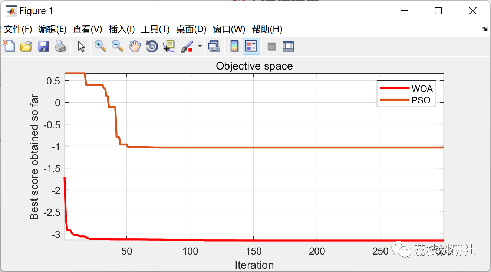

# Comparative Study of Whale Optimization Algorithm and Particle Swarm Optimization Algorithm (Matlab Code Implementation)

💥💥💥💞💞💞💞 Welcome to this blog❤️❤️❤️💥💥💥
🏆 Bloggers' Advantage: 🌞🌞🌞 The content of the blog strives to be rigorous in thought and clear in logic, for the convenience of readers.
⛳️ Mantra: The journey of a hundred miles is half done in the last ninety.
🎁Column Directory Link:
🌈🌈🌈🌟🌟🌟Electrical Code Intelligent Algorithm and Its Application Path Planning Neural Network Predictive Optimization Scheduling Image Processing Workshop Scheduling Signal Processing Romantic Her My Philosophical Thoughts Math Modeling Complete Code Matters
💥1 Whale Optimization Algorithm
The Whale Optimization Algorithm is a metaheuristic population-based optimization algorithm that simulates the hunting behavior of whales. It was first proposed by Mirjalili et al. in 2016. This algorithm is simple to operate, has few parameters, and achieves high speed and strong stability. It is commonly used to solve various optimization problems in computational issues. After a long evolutionary process, whales have developed a unique hunting strategy, which involves finding prey through "spiral bubble net" paths, encircling prey, and capturing prey. The Whale Optimization Algorithm is based on these three hunting steps to establish corresponding mathematical models.
📚2 Particle Swarm Optimization Algorithm
Particle Swarm Optimization (PSO) is a classic swarm intelligence algorithm, inspired by the social activities of birds in flight and foraging. The flock searches for the global optimum through information exchange among individual birds. PSO has several advantages such as its simplicity in principle, minimal parameter settings, and ease of implementation. Therefore, it has attracted widespread attention and research from scholars in recent years.
🎉3 Running Results
👨‍💻4 Matlab code implementation
​\n​\nclear all \nclc\n​\nSearchAgents_no=50; % Number of search agents\n​\nFunction_name='F20'; % Name of the test function that can be from F1 to F23 (Table 1,2,3 in the paper)\n​\nMax_iteration\n=\n300\n; % Maximum numbef of iterations​\n% Load details of the selected benchmark function\n[lb,ub,dim,fobj]=Get_Functions_details(Function_name); \n​\n[Best_score,Best_pos,WOA_cg_curve]=WOA(SearchAgents_no,Max_iteration,lb,ub,dim,fobj); \n​\nfigure('Position',[269   240   660   290])\n%Draw search space\n% subplot(1,2,1); \n% func_plot(Function_name); \n% title('Parameter space')\n% xlabel('x_1'); \n% ylabel('x_2'); \n% zlabel([Function_name,'( x_1 , x_2 )'])\n​\n%Draw objective space\n%subplot(1,2,2); \n%semilogy(WOA_cg_curve,'Color','r')\n%title('Objective space')\n%xlabel('Iteration'); \n%ylabel('Best score obtained so far'); \nplot(WOA_cg_curve,'LineWidth',2,'Color','r')\ntitle('Objective space')\nxlabel('Iteration'); \nylabel('Best score obtained so far'); \n​\naxis tight\ngrid on\nbox on\nhold on; \nClick the "Read More" button at the bottom left of this article to view the complete code.
Or reply with the keyword: Comparison between whales and particle swarm

## Images

<!-- PAYMENT_BLOCK -->

## Get this dataset

- Payment link (Stripe): [Buy now](https://buy.stripe.com/3cs8yP7sY87d0vu9AB)
- Payment QR code: 

<!-- /PAYMENT_BLOCK -->
